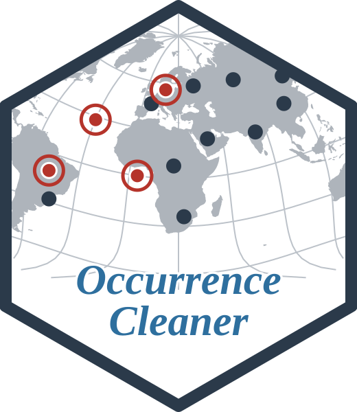
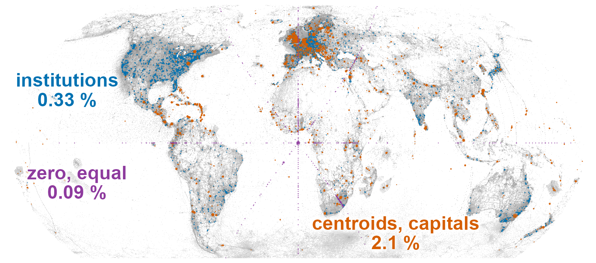

```{r setup, include = FALSE}
knitr::opts_chunk$set(collapse = TRUE, comment = "#>")
options(width = 80)
```

# OccurrenceCleaner 

*Check occurrence records, at any scale*

<!-- badges: start -->
[](https://github.com/gcol33/OccurrenceCleaner/actions/workflows/R-CMD-check.yaml)
[](https://app.codecov.io/gh/gcol33/OccurrenceCleaner)
[](https://opensource.org/licenses/MIT)
<!-- badges: end -->

<p align="center"></p>

OccurrenceCleaner checks species occurrence records for potential problems, such as coordinates at country centroids or museums, in the sea, or far from other records of the same species.

The package extends [CoordinateCleaner](https://ropensci.github.io/CoordinateCleaner/) (Zizka et al. 2019), the R package that defines these tests and runs them on a data frame in memory. OccurrenceCleaner runs the same tests as nearest-neighbour queries in C++ and streams tables from disk, so they can be applied to a full snapshot of the Global Biodiversity Information Facility (GBIF). It also adds tests of its own and expands the reference data.

Each test stores its result as a flag alongside the record. All records remain available, so you can inspect their flags, compare how different combinations of tests affect the dataset, and choose which records to exclude. OccurrenceCleaner supports:

- **Large tables.** Ten million records go through the capital proximity test in 1.4 seconds on a desktop machine ([timings](https://gillescolling.com/OccurrenceCleaner/articles/coordinatecleaner.html#timings)). A full GBIF snapshot containing billions of records in 288 GB of Parquet files can be processed on a desktop computer using a single R process. Files are processed in chunks, keeping memory use bounded regardless of dataset size, without requiring a cluster. Progress is saved, allowing interrupted runs to resume.
- **Comparing cleaning rules.** Compute the flags once, then choose which tests determine whether to exclude a record. [`tally_flags()`](https://gillescolling.com/OccurrenceCleaner/reference/tally_flags.html) reports how many records each rule removes per taxon, period or precision class, providing counts for a methods section or data paper.
- **An extended list of institutions.** Records are checked against 18,245 museum, herbarium and botanic garden locations to identify coordinates that may refer to the institution holding the specimen. The list combines the GBIF Registry of Scientific Collections (GRSciColl), Wikidata, Wikipedia’s natural history museum lists in seven languages, GeoNames and Botanic Gardens Conservation International (BGCI). It includes 7,665 locations from sources beyond those used by CoordinateCleaner. These additional locations are included by default; you can restrict the test to CoordinateCleaner’s sources ([Extension points](https://gillescolling.com/OccurrenceCleaner/articles/reference-data.html#extension-points)).
- **Checks based on GBIF metadata.** Tests check GBIF’s reported issues, the type of record, and whether the organism is recorded as native or introduced. Habitat information for the recorded genus helps distinguish marine from terrestrial taxa.

The tests follow CoordinateCleaner’s definitions and default buffers, with documented differences in [Compatibility with CoordinateCleaner](https://gillescolling.com/OccurrenceCleaner/articles/coordinatecleaner.html). Automated checks run both packages on sampled records and require matching flags for the shared behaviour. A methods section can cite CoordinateCleaner for the original tests and describe the tests and settings used in OccurrenceCleaner.

## Installation

```r
# install.packages("pak")
pak::pak("gcol33/OccurrenceCleaner")
```

The package compiles C++ code: [Rtools](https://cran.r-project.org/bin/windows/Rtools/) on Windows, `xcode-select --install` on macOS, `r-base-dev` on Debian and Ubuntu. `pkgbuild::has_build_tools(debug = TRUE)` checks that R finds the compiler.

## Usage

1. Flag the records with `flag_occurrences()`. By default it runs every test the columns allow.
2. Choose a cleaning rule, the set of tests used for filtering, and keep the records it does not flag with `keep_unflagged()`.
3. Compare rules per species, period or dataset with `tally_flags()`.

`test_plan()` shows which tests run on a table and why each other test does not. `flag_tests()` lists every test with its definition and the columns it needs.

The input is a data frame, or a path to a table on disk ([Processing large datasets on disk](#processing-large-datasets-on-disk)). Coordinates are longitude and latitude in decimal degrees (WGS84). Columns are matched by their Darwin Core names, the standard field names for biodiversity data, regardless of capitalisation. Other column names are mapped with `occ_columns()`.

Each test reads a few columns, and by default every test whose columns are present runs. To run only some tests, name them in `tests`. If a named test lacks one of its columns, the call stops and reports which column is missing.

```{r flag}
library(OccurrenceCleaner)

x <- data.frame(
  species = c("Quercus robur", "Quercus robur",
              "Fagus sylvatica", "Fagus sylvatica"),
  decimalLongitude = c(12.58, 0, 16.37, 14.05),
  decimalLatitude = c(55.67, 0, 48.21, 47.85)
)
f <- flag_occurrences(x)
f[, c("species", "flag_zero", "flag_capital",
      "flag_gbif_headquarters", "flag_sea")]
```

A flag is TRUE when the record fails the test. The first record lies within 1 km of the GBIF headquarters in Copenhagen and within 10 km of the capital, the second is a zero coordinate at sea, the third is in Vienna, and the fourth, in rural Upper Austria, passes every test. The integer `flags` column encodes every test of a record, one bit per test.

Running a test only adds its flag, so the default runs every test the data allows. Which records to exclude is a separate choice, made afterwards with a cleaning rule. A rule specifies which tests to use when filtering: a record is excluded if any test in the rule flags it.

A flagged record may still be valid: a real observation can lie within 10 km of a capital, so you choose the tests that suit your analysis. A rule for species distribution modelling might exclude fossil and living specimens along with coordinate problems, and another study can choose a different set. You can compare several rules on the same flags, then select the records to keep:

```{r rules}
strict <- c("zero", "equal", "capital", "centroid", "institution",
            "gbif_headquarters", "sea")
mild   <- c("zero", "equal", "gbif_headquarters")

has_flag(f, strict)
tally_flags(f, by = "species", rules = list(strict = strict, mild = mild))

kept <- keep_unflagged(f, mild)
kept[, c("species", "decimalLongitude", "decimalLatitude")]
```

[Choosing a cleaning rule](https://gillescolling.com/OccurrenceCleaner/articles/rules.html) compares rules on a larger table, with year and coordinate uncertainty cut into bins at tally time.

## The tests

The package has 30 tests. Twenty carry CoordinateCleaner's definitions and defaults, from zero coordinates and capital buffers to species outliers, gridded datasets and fossil ages. The other ten are additions that read GBIF's issue warnings, basis of record and establishment means, and set the land test against the habitat of the record's genus. [The tests in detail](https://gillescolling.com/OccurrenceCleaner/articles/tests.html) gives each test's definition, default and source, and `flag_tests()` returns the same table in R.

The reference data (the point lists of capitals, country centroids and institutions, and the land polygons) is rebuilt from public sources. Each layer is pinned by version and checksum and recorded with the flags, so a cleaning can be repeated later. [Reference data](https://gillescolling.com/OccurrenceCleaner/articles/reference-data.html) lists each layer with its source and version; `reference = "CoordinateCleaner"` uses that package's own tables instead, and the `gazetteers` argument replaces a test's points or polygons with the user's own.

## Using OccurrenceCleaner in an analysis

- The input is any table with Darwin Core coordinate and species columns, such as a GBIF download from [rgbif](https://docs.ropensci.org/rgbif/), a fossil table from the Paleobiology Database via [paleobioDB](https://cran.r-project.org/package=paleobioDB), or another aggregator's export.
- Taxonomic names are matched beforehand, for example with [taxify](https://gillescolling.com/taxify/) or [taxize](https://docs.ropensci.org/taxize/).
- The records are flagged with `flag_occurrences()`, and a cleaning rule is chosen by comparing rules with `tally_flags()`.
- The retained records go to species distribution models ([dismo](https://cran.r-project.org/package=dismo), [sdm](https://cran.r-project.org/package=sdm)), biogeography on phylogenies ([phytools](https://cran.r-project.org/package=phytools)), IUCN Red List assessments ([red](https://cran.r-project.org/package=red)) or, for fossils, PyRate through `export_pyrate()`.

## Outliers and dataset tests

The outlier and dataset tests judge a record against the rest of its species or dataset, so they run in a pass over the whole input before the record tests, streamed input included. Their options go in `settings`, with CoordinateCleaner's defaults:

```r
tests <- c("invalid", "outlier", "dataset_ddmm", "dataset_rounded")
mad <- list(outlier = list(method = "mad"))
flag_occurrences(occ, tests = tests, settings = mad)
```

[Outliers and dataset tests](https://gillescolling.com/OccurrenceCleaner/articles/outliers.html) shows each method on simulated records.

## Fossil records

A table from the Paleobiology Database goes through `flag_occurrences()` too, with the age test and the fossil outlier tests of CoordinateCleaner's `clean_fossils()`. Its column names are given once through `occ_columns()`:

```r
tests <- c("invalid", "zero", "centroid", "institution",
           "age_equal", "age_range_outlier", "spatiotemporal_outlier")
pbdb_cols <- occ_columns(lon = "lng", lat = "lat", species = "accepted_name")
flag_occurrences(pbdb, tests = tests, columns = pbdb_cols)
```

[Cleaning fossil records](https://gillescolling.com/OccurrenceCleaner/articles/fossils.html) goes from a PBDB download to PyRate input files.

## Processing large datasets on disk

`flag_occurrences()` uses [vectra](https://gillescolling.com/vectra/) to process tables stored on disk, including GBIF snapshots. It accepts a directory of Parquet files, a `.vtr` file, a delimited text file or a vectra query node.

The function flags and writes each input file separately. If processing is interrupted, rerunning the call skips completed files. The `keep` argument specifies which input columns to save alongside the flags for grouping:

```r
keep <- c("kingdom", "year", "coordinateuncertaintyinmeters")
f <- flag_occurrences("gbif_snapshot/occurrence.parquet",
                      out = "flags", keep = keep)

coordinatecleaner <- c("zero", "equal", "capital", "centroid", "institution",
                       "gbif_headquarters", "sea")
tally_flags(f, by = "kingdom", bins = list(year = c(1950, 1970, 1990, 2000)),
            rules = list(coordinatecleaner = coordinatecleaner))
```

See [Large tables on disk](https://gillescolling.com/OccurrenceCleaner/articles/on-disk.html) for details on output files, memory use and resuming interrupted runs.

## Documentation

Start with [Get started](https://gillescolling.com/OccurrenceCleaner/articles/OccurrenceCleaner.html): one path from a data frame to the records that pass a cleaning rule.

- [Cleaning GBIF data](https://gillescolling.com/OccurrenceCleaner/articles/gbif-workflow.html): a GBIF download flagged, compared under several rules and filtered.
- [Choosing a cleaning rule](https://gillescolling.com/OccurrenceCleaner/articles/rules.html): what each rule removes, per group.
- [Large tables on disk](https://gillescolling.com/OccurrenceCleaner/articles/on-disk.html): streaming a snapshot.
- [Cleaning fossil records](https://gillescolling.com/OccurrenceCleaner/articles/fossils.html): PBDB tables and PyRate export.
- [The tests in detail](https://gillescolling.com/OccurrenceCleaner/articles/tests.html): what each test checks, its default and source.
- [Outliers and dataset tests](https://gillescolling.com/OccurrenceCleaner/articles/outliers.html): the tests that judge a record against its group.
- [Reference data](https://gillescolling.com/OccurrenceCleaner/articles/reference-data.html): where each layer of reference data comes from and how it differs from CoordinateCleaner's.
- [Using custom gazetteers](https://gillescolling.com/OccurrenceCleaner/articles/gazetteers.html): the user's own points, polygons and species ranges in place of the shipped reference data.
- [Compatibility with CoordinateCleaner](https://gillescolling.com/OccurrenceCleaner/articles/coordinatecleaner.html): function and argument mapping, every documented difference, timings.
- [Full reference](https://gillescolling.com/OccurrenceCleaner/reference/): every function, grouped by job.

## Getting help

Questions and bug reports go to the [GitHub issues](https://github.com/gcol33/OccurrenceCleaner/issues). A bug report is easiest to act on with a small reproducible example, for instance made with [reprex](https://reprex.tidyverse.org/).

## Contributing

Pull requests are welcome; see the [contributing guide](https://gillescolling.com/OccurrenceCleaner/CONTRIBUTING.html).

## Support

> "Software is like sex: it's better when it's free." — Linus Torvalds

I'm a PhD student who builds R packages in my free time because I believe good tools should be free and open. I started these projects for my own work and figured others might find them useful too.

If this package saved you some time, buying me a coffee is a nice way to say thanks. It helps with my coffee addiction.

[](https://buymeacoffee.com/gcol33)

## Acknowledgements

The tests, their default buffers and the options of the outlier and dataset tests come from [CoordinateCleaner](https://ropensci.github.io/CoordinateCleaner/) by Alexander Zizka and co-authors (Zizka et al. 2019), an rOpenSci package. Its documented definitions are what the equivalence tests check against, and the reference data here is rebuilt from the public sources it draws on.

## License

MIT. [CoordinateCleaner](https://ropensci.github.io/CoordinateCleaner/) (GPL-3) is a suggested package used by the equivalence tests and by `reference = "CoordinateCleaner"`; none of its code or data is bundled. The country centroid points from the World Borders Dataset (Bjorn Sandvik, thematicmapping.org) are under CC BY-SA.

## Citation

```{r citation, echo = FALSE, comment = ""}
print(citation("OccurrenceCleaner"), bibtex = TRUE)
```
