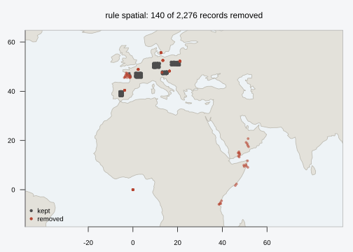
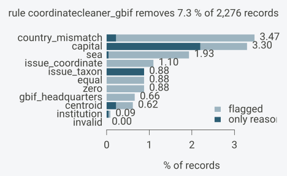
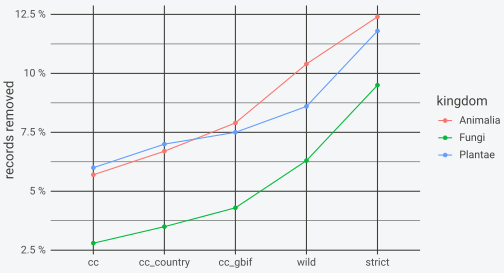

# Cleaning GBIF data

This article runs the whole cleaning workflow on a table shaped like a
GBIF download: flag every record once with all the tests that apply,
look at what each test caught, and then compare several cleaning rules
over the same flags before choosing one. The data are simulated so that
every error is known, which makes it possible to check that each test
catches what it should and nothing else.

``` r

library(OccurrenceCleaner)
library(ggplot2)
```

## Example data

GBIF’s simple-format downloads and the Parquet snapshot hold the Darwin
Core terms in lower case (`decimallongitude`, `countrycode`,
`basisofrecord`, …). The column matching in
[`occ_columns()`](https://gillescolling.com/OccurrenceCleaner/reference/occ_columns.md)
is case-insensitive, so these names are found without renaming. The
simulated table has 2,000 clean records spread over the interiors of
five European countries, each with the right country code:

``` r

set.seed(42)
boxes <- data.frame(code = c("AT", "DE", "FR", "ES", "PL"),
                    lon0 = c(13.0, 9.0, 1.0, -6.0, 17.0), lon1 = c(15.5, 12.0, 4.0, -4.5, 21.0),
                    lat0 = c(47.0, 49.5, 45.5, 38.0, 50.5), lat1 = c(48.0, 51.5, 47.5, 40.0, 52.0))
n <- 2000
b <- boxes[sample(nrow(boxes), n, TRUE), ]
spp <- c("Quercus robur", "Fagus sylvatica", "Bufo bufo", "Lucanus cervus", "Amanita muscaria")
occ <- data.frame(
  gbifid = as.character(seq_len(n)),
  species = sample(spp, n, TRUE),
  decimallongitude = round(runif(n, b$lon0, b$lon1), 5),
  decimallatitude = round(runif(n, b$lat0, b$lat1), 5),
  countrycode = b$code,
  year = sample(c(1850:2024), n, TRUE, prob = seq(0.2, 3, length.out = 175)),
  coordinateuncertaintyinmeters = sample(c(NA, 10, 30, 100, 1000, 5000), n, TRUE),
  basisofrecord = sample(c("HUMAN_OBSERVATION", "PRESERVED_SPECIMEN"), n, TRUE, c(0.8, 0.2)),
  establishmentmeans = NA_character_,
  issue = "")
occ$kingdom <- ifelse(grepl("Quercus|Fagus", occ$species), "Plantae",
                      ifelse(occ$species == "Amanita muscaria", "Fungi", "Animalia"))
```

To these I add 236 records with the errors that the tests target, each
group labelled in a column `truth` so the flags can be checked against
it afterwards. Herbarium sheets georeferenced to the capital where they
are kept, coordinates typed as zeros, the GBIF headquarters in
Copenhagen as a default location, swapped and negated coordinates,
coordinates entered at whole degrees, botanic-garden specimens and
cultivated plants, plus 40 exact copies of clean records:

``` r

err <- function(k, truth, lon, lat, code, ...) {
  d <- occ[sample(n, k), ]
  d$gbifid <- paste0(truth, "-", seq_len(k))
  d$decimallongitude <- lon; d$decimallatitude <- lat; d$countrycode <- code
  extra <- list(...)
  for (nm in names(extra)) d[[nm]] <- extra[[nm]]
  d$truth <- truth
  d
}
occ$truth <- "clean"
capitals <- data.frame(lon = c(16.37, 2.35, -3.70, 13.40, 21.01), lat = c(48.21, 48.86, 40.42, 52.52, 52.23),
                       code = c("AT", "FR", "ES", "DE", "PL"))
k <- sample(5, 60, TRUE)
bad <- rbind(
  err(60, "capital", capitals$lon[k] + rnorm(60, 0, 0.01), capitals$lat[k] + rnorm(60, 0, 0.01),
      capitals$code[k], basisofrecord = "PRESERVED_SPECIMEN", year = sample(1850:1950, 60, TRUE)),
  err(20, "zero", 0, 0, NA),
  err(15, "gbif_hq", 12.58, 55.67, "DK"),
  err(25, "swapped", occ$decimallatitude[1:25], occ$decimallongitude[1:25], occ$countrycode[1:25],
      issue = "PRESUMED_SWAPPED_COORDINATE"),
  err(25, "negated", -occ$decimallongitude[occ$countrycode == "FR"][1:25],
      occ$decimallatitude[occ$countrycode == "FR"][1:25], "FR"),
  err(30, "rounded", round(occ$decimallongitude[1:30]), round(occ$decimallatitude[1:30]),
      occ$countrycode[1:30], coordinateuncertaintyinmeters = NA),
  err(20, "living", occ$decimallongitude[31:50], occ$decimallatitude[31:50], occ$countrycode[31:50],
      basisofrecord = "LIVING_SPECIMEN"),
  err(21, "cultivated", occ$decimallongitude[51:71], occ$decimallatitude[51:71],
      occ$countrycode[51:71], establishmentmeans = "CULTIVATED"),
  err(20, "fuzzy_taxon", occ$decimallongitude[72:91], occ$decimallatitude[72:91],
      occ$countrycode[72:91], issue = "TAXON_MATCH_FUZZY;COORDINATE_ROUNDED"))
dups <- occ[sample(n, 40), ]; dups$gbifid <- paste0("dup-", 1:40); dups$truth <- "duplicate"
occ <- rbind(occ, bad, dups)
table(occ$truth)
#> 
#>     capital       clean  cultivated   duplicate fuzzy_taxon     gbif_hq 
#>          60        2000          21          40          20          15 
#>      living     negated     rounded     swapped        zero 
#>          20          25          30          25          20
```

The `issue` column holds GBIF’s issue names separated by `;`, which is
how both the simple-format download and the snapshot read through vectra
deliver them; a list column of character vectors works too.

## Flagging every test once

All nineteen tests can run here, because the table has coordinates, a
species, a country code and the three GBIF fields.
[`occ_columns()`](https://gillescolling.com/OccurrenceCleaner/reference/occ_columns.md)
only needs to be told the identifier, since the other defaults match
case-insensitively:

``` r

all_tests <- flag_tests()$test
f <- flag_occurrences(occ, tests = all_tests, columns = occ_columns(id = "gbifid"))
dim(f)
#> [1] 2276   32
attr(f, "occ_reference")
#> [1] "natural_earth (land 110; land_110 4.1.0, land_50 4.1.0, land_10 5.1.1, countries_50 5.1.1, urban_50 4.1.0, places_10 5.1.2, admin0_10 5.1.1, admin1_10 5.1.1, institutions 2026-10-09)"
```

The result is the input with an integer `flags` column and one logical
column per test. The `occ_reference` attribute records which gazetteer
versions produced the flags; it is worth storing next to any cleaned
table that goes into an analysis.

[`summary()`](https://rdrr.io/r/base/summary.html) turns the flags into
shares per test. With one rule holding every test, it gives for each
test the records it flags, their percentage, and the records for which
it is the only flag:

``` r

s <- as.data.frame(summary(f, rules = list(all = all_tests)))
knitr::kable(s[s$flagged > 0, c("test", "flagged", "pct", "only")], digits = 2, row.names = FALSE)
```

| test                  | flagged |   pct | only |
|:----------------------|--------:|------:|-----:|
| zero                  |      20 |  0.88 |    0 |
| equal                 |      20 |  0.88 |    0 |
| capital               |      75 |  3.30 |    0 |
| centroid              |       9 |  0.40 |    0 |
| institution           |      20 |  0.88 |    0 |
| gbif_headquarters     |      15 |  0.66 |    0 |
| sea                   |      44 |  1.93 |    1 |
| urban                 |      80 |  3.51 |   19 |
| country_mismatch      |      79 |  3.47 |    5 |
| duplicate             |      87 |  3.82 |   42 |
| issue_coordinate      |      25 |  1.10 |    0 |
| issue_taxon           |      20 |  0.88 |    0 |
| issue_rounded         |      20 |  0.88 |    0 |
| basis_living          |      20 |  0.88 |   13 |
| establishment_managed |      21 |  0.92 |   14 |
| (any)                 |     263 | 11.56 |      |

The `(any)` row is the rule as a whole: 263 of the 2,276 records carry
at least one flag. The `only` column is the number of records a rule
would keep if that one test were dropped from it.

Because the errors are labelled, a cross table of the truth against a
few tests shows which test catches which kind of error, and whether any
clean record is flagged:

``` r

show <- c("zero", "capital", "gbif_headquarters", "sea", "country_mismatch", "duplicate",
          "issue_coordinate", "issue_rounded", "basis_living", "establishment_managed")
tab <- aggregate(f[paste0("flag_", show)], by = list(truth = f$truth), FUN = sum)
names(tab) <- c("truth", show)
knitr::kable(tab)
```

| truth | zero | capital | gbif_headquarters | sea | country_mismatch | duplicate | issue_coordinate | issue_rounded | basis_living | establishment_managed |
|:---|---:|---:|---:|---:|---:|---:|---:|---:|---:|---:|
| capital | 0 | 60 | 0 | 0 | 0 | 0 | 0 | 0 | 0 | 0 |
| clean | 0 | 0 | 0 | 0 | 2 | 0 | 0 | 0 | 0 | 0 |
| cultivated | 0 | 0 | 0 | 0 | 0 | 7 | 0 | 0 | 0 | 21 |
| duplicate | 0 | 0 | 0 | 0 | 0 | 40 | 0 | 0 | 0 | 0 |
| fuzzy_taxon | 0 | 0 | 0 | 0 | 0 | 5 | 0 | 20 | 0 | 0 |
| gbif_hq | 0 | 15 | 15 | 0 | 15 | 10 | 0 | 0 | 0 | 0 |
| living | 0 | 0 | 0 | 0 | 0 | 7 | 0 | 0 | 20 | 0 |
| negated | 0 | 0 | 0 | 15 | 17 | 0 | 0 | 0 | 0 | 0 |
| rounded | 0 | 0 | 0 | 0 | 0 | 3 | 0 | 0 | 0 | 0 |
| swapped | 0 | 0 | 0 | 9 | 25 | 0 | 25 | 0 | 0 | 0 |
| zero | 20 | 0 | 0 | 20 | 20 | 15 | 0 | 0 | 0 | 0 |

Most error types trip more than one test. All 25 swapped records fail
`country_mismatch` and carry GBIF’s own `PRESUMED_SWAPPED_COORDINATE`
warning (`issue_coordinate`); 9 of them also land at sea. The 15
GBIF-headquarters records are flagged by `gbif_headquarters` and
`capital` (Copenhagen is within 10 km), and by `country_mismatch`,
because the point lies just off the 1:50m Natural Earth coastline of
Denmark that the country test uses, while the 1:110m land of the `sea`
test still covers it. The zero coordinates fail `zero`, `equal`, `sea`
and `country_mismatch`, and also `institution`: three GRSciColl
institutions (in Coimbra, Bornova and Hsinchu) are registered with
coordinates within a few hundred metres of (0, 0), so the institution
gazetteer itself carries the zero-coordinate error.

The negated longitudes show the limit of the spatial tests. Only 17 of
25 are caught: a French record at 1.5 E negated to 1.5 W is still in
western France, on land and in the right country, and no record test can
tell it from a correct one. None of the 30 records entered at whole
degrees is caught: a whole-degree point in Austria is still in Austria,
and GBIF’s `COORDINATE_ROUNDED` warning does not mark them, since it
records that GBIF itself rounded a coordinate to five decimals. Low
precision of this kind is read from `coordinateuncertaintyinmeters` when
the source states it; these 30 records state none.

Of the 2,000 clean records, 1,998 carry no flag in these columns. The
other two lie at 13.0 E, 47.6 to 47.7 N, inside the Austrian box but
across the border in Bavaria, so `country_mismatch` is right about them.
The duplicates among the injected groups (7 cultivated, 7 living, 10 at
the GBIF headquarters) arise because those records copy the coordinates
of existing records and sometimes draw the same species.

## Where the flagged records are

[`plot()`](https://rdrr.io/r/graphics/plot.default.html) with
`type = "map"` draws the records over the Natural Earth land, coloured
by whether a rule removes them. With the CoordinateCleaner-equivalent
spatial tests as the rule, the capital clusters, the point at (0, 0),
the swapped records in Arabia and East Africa and the negated ones in
the Atlantic stand out:

``` r

spatial <- c("zero", "equal", "capital", "centroid", "institution", "gbif_headquarters",
             "sea", "country_mismatch")
plot(f, type = "map", rules = list(spatial = spatial))
```



## How often tests coincide

A record is removed by a rule when it carries any test of that rule, so
the overlap between tests decides how much each extra test adds. The
flag word makes the combinations easy to count: each distinct value of
`flags` is one combination of tests.

``` r

flagged <- f[f$flags != 0L, ]
combo <- vapply(flagged$flags, function(w)
  paste(all_tests[vapply(all_tests, function(t) has_flag(w, t), logical(1))], collapse = " + "),
  character(1))
knitr::kable(head(sort(table(combo), decreasing = TRUE), 12), col.names = c("tests", "records"))
```

| tests                                                           | records |
|:----------------------------------------------------------------|--------:|
| capital + urban                                                 |      51 |
| duplicate                                                       |      42 |
| urban                                                           |      19 |
| country_mismatch + issue_coordinate                             |      16 |
| issue_taxon + issue_rounded                                     |      15 |
| zero + equal + institution + sea + country_mismatch + duplicate |      15 |
| establishment_managed                                           |      14 |
| sea + country_mismatch                                          |      14 |
| basis_living                                                    |      13 |
| capital + gbif_headquarters + country_mismatch + duplicate      |      10 |
| capital + centroid + urban                                      |       9 |
| sea + country_mismatch + issue_coordinate                       |       9 |

The most common combination is `capital + urban`: a capital lies inside
its own urban area, so in a rule that already holds `capital`, adding
`urban` removes only the city records more than 10 km from the capital
point. The 15 zero-coordinate records carry six tests at once. Records
with a single flag (`duplicate`, `issue_rounded`,
`establishment_managed`, `basis_living`) are the ones a rule keeps or
loses depending on whether that one test is in it.

## Comparing cleaning rules

A cleaning rule is a set of tests. Five rules, from loose to strict,
show the range of choices on the same flags:

- `cc`: the CoordinateCleaner defaults of
  [`clean_coordinates()`](https://ropensci.github.io/CoordinateCleaner/reference/clean_coordinates.html)
  without the outlier test (zero, equal, capital, centroid, institution,
  GBIF headquarters, sea);

- `cc_country`: `cc` plus the country check;

- `cc_gbif`: `cc_country` plus GBIF’s coordinate and taxon warnings;

- `wild`: `cc_gbif` plus living specimens and cultivated or managed
  individuals;

- `strict`: every test, including duplicates and GBIF’s rounding note.

``` r

rules <- list(
  cc = c("zero", "equal", "capital", "centroid", "institution", "gbif_headquarters", "sea"))
rules$cc_country <- c(rules$cc, "country_mismatch")
rules$cc_gbif <- c(rules$cc_country, "issue_coordinate", "issue_taxon")
rules$wild <- c(rules$cc_gbif, "basis_living", "establishment_managed")
rules$strict <- all_tests
t_all <- tally_flags(f, rules = rules)
knitr::kable(t_all[, c("n", paste0("removed_", names(rules)))])
```

| n | removed_cc | removed_cc_country | removed_cc_gbif | removed_wild | removed_strict |
|---:|---:|---:|---:|---:|---:|
| 2276 | 119 | 140 | 160 | 201 | 263 |

The ladder removes 119 records under `cc` and 263 under `strict`. The
country check adds 21, the GBIF warnings 20, the living and cultivated
records 41, and duplicates the remaining 62 (the 20 records with
`issue_rounded` are already removed through `issue_taxon`).

For one rule, [`plot()`](https://rdrr.io/r/graphics/plot.default.html)
on the summary draws a bar per test: the full bar is the share the test
flags, the dark part the share for which it is the only reason the rule
removes the record. A test with a long light bar and a short dark one
mostly flags records that other tests in the rule remove anyway:

``` r

plot(summary(f, rules = rules["cc_gbif"]))
```



[`tally_flags()`](https://gillescolling.com/OccurrenceCleaner/reference/tally_flags.md)
returns `removed_<rule>` and `kept_<rule>` for every rule, plus
`flagged_<test>` for every test, per group. Grouped by kingdom it shows
whether a rule hits one group harder than another:

``` r

t_k <- tally_flags(f, by = "kingdom", rules = rules)
t_k[paste0("share_", names(rules))] <- round(t_k[paste0("removed_", names(rules))] / t_k$n, 3)
knitr::kable(t_k[, c("kingdom", "n", paste0("share_", names(rules)))])
```

| kingdom  |   n | share_cc | share_cc_country | share_cc_gbif | share_wild | share_strict |
|:---------|----:|---------:|-----------------:|--------------:|-----------:|-------------:|
| Animalia | 897 |    0.057 |            0.067 |         0.079 |      0.104 |        0.124 |
| Fungi    | 461 |    0.028 |            0.035 |         0.043 |      0.063 |        0.095 |
| Plantae  | 918 |    0.060 |            0.070 |         0.075 |      0.086 |        0.118 |

The same table as a figure, one line per kingdom across the rule ladder:

``` r

long <- do.call(rbind, lapply(names(rules), function(r)
  data.frame(kingdom = t_k$kingdom, rule = r, share = t_k[[paste0("share_", r)]])))
long$rule <- factor(long$rule, levels = names(rules))
ggplot(long, aes(rule, share, colour = kingdom, group = kingdom)) +
  geom_line() + geom_point() +
  scale_y_continuous(labels = function(v) paste0(100 * v, " %")) +
  labs(x = NULL, y = "records removed") +
  theme_minimal() +
  theme(panel.background = element_rect(fill = "transparent", colour = NA),
        plot.background = element_rect(fill = "transparent", colour = NA))
```



## Record age and coordinate uncertainty

Year and stated coordinate uncertainty are not tests. They stay raw
columns and are cut into bins at tally time, so the same flags support
any age or precision threshold. Grouping by year bin shows where a rule
removes most:

``` r

t_y <- tally_flags(f, bins = list(year = c(1900, 1950, 2000)), rules = rules["cc_country"])
t_y$share <- round(t_y$removed_cc_country / t_y$n, 3)
knitr::kable(t_y[, c("year_bin", "n", "flagged_capital", "removed_cc_country", "share")])
```

| year_bin  |   n | flagged_capital | removed_cc_country | share |
|:----------|----:|----------------:|-------------------:|------:|
| \<1900    | 267 |              31 |                 37 | 0.139 |
| 1900-1950 | 605 |              34 |                 52 | 0.086 |
| 1950-2000 | 846 |               7 |                 33 | 0.039 |
| \>=2000   | 558 |               3 |                 18 | 0.032 |

The rule removes 13.9 % of the records before 1900 and 3.2 % of those
from 2000 on, because the capital-georeferenced herbarium sheets were
simulated with years before 1950. Uncertainty bins work the same way;
records without a stated uncertainty form the group `"missing"`:

``` r

t_u <- tally_flags(f, bins = list(coordinateuncertaintyinmeters = c(100, 1000)),
                   rules = rules["cc_country"])
knitr::kable(t_u[, c("coordinateuncertaintyinmeters_bin", "n", "removed_cc_country", "kept_cc_country")])
```

| coordinateuncertaintyinmeters_bin |   n | removed_cc_country | kept_cc_country |
|:----------------------------------|----:|-------------------:|----------------:|
| \<100                             | 775 |                 59 |             716 |
| 100-1000                          | 370 |                 23 |             347 |
| \>=1000                           | 736 |                 36 |             700 |
| missing                           | 395 |                 22 |             373 |

A threshold on uncertainty is then a filter on the raw column next to
the rule, for example keeping records with a stated uncertainty of at
most 1 km:

``` r

keep <- !has_flag(f$flags, rules$cc_country) &
  !is.na(f$coordinateuncertaintyinmeters) & f$coordinateuncertaintyinmeters <= 1000
c(records = nrow(f), kept = sum(keep))
#> records    kept 
#>    2276    1423
```

## The cleaned table

Applying a rule is a single subset. The flags stay attached, so a later
analysis can still tell which tests the kept records passed and can
tighten the rule without rerunning anything:

``` r

clean <- f[!has_flag(f$flags, rules$wild), ]
nrow(clean)
#> [1] 2075
table(clean$truth)
#> 
#>     clean duplicate   negated   rounded 
#>      1998        40         7        30
```

The `wild` rule keeps 1,998 of the 2,000 clean records and removes every
injected error except the 40 duplicates, which it does not target, the
30 whole-degree records and the 7 negated records, which no record test
can see. The 20 records with a fuzzy taxon match are removed through
`issue_taxon`, although their coordinates are fine.

## Practical guidance

- **Run every test that the columns allow, once.** The pass over the
  records is the expensive step; rules are a bit-mask query afterwards.
  On worky (Ryzen 7 5700G) the nine default tests took 1.9 s for one
  million records in memory (`dev_notes/benchmark.md`), so there is
  little reason to run fewer tests than the data support.

- **`country_mismatch` needs a country code and flags records without
  one.** A record with no code, or one that falls at sea, is flagged, as
  in CoordinateCleaner. In a GBIF table where many records lack
  `countrycode`, that test alone can flag a large share; the tally per
  test shows it before it goes into a rule.

- **`sea` depends on the land scale.** The default 1:110m land is
  coarse: in the example the GBIF headquarters are on land at that scale
  and at sea on the 1:50m coast. For coastal or island taxa,
  `land_scale = 50` or `10` changes the result for records within a few
  kilometres of the coast; the reference-data article shows the size of
  the difference.

- **`duplicate` depends on what counts as the same record.** By default
  it is the same coordinates and the same `species` value. Adding
  `duplicate_by = "eventdate"` keeps repeat visits apart;
  `duplicate_cell = 0.1` treats records in the same 0.1-degree cell as
  duplicates, which suits a grid-based analysis. On streamed input
  duplicates are found within each input file only (see the on-disk
  article).

- **GBIF issue tests are GBIF’s own processing results.** They catch
  errors that the spatial tests cannot see (a swapped coordinate that
  still lands on land, a fuzzy taxon match). `issue_rounded` is a
  precision note rather than an error: GBIF sets `COORDINATE_ROUNDED`
  when it rounds a coordinate given with more than five decimals, which
  moves the point by at most about 1 m.

- **Do not cut at a threshold during flagging.** Year, uncertainty and
  any other numeric field belong in `bins` or in a subset after the
  rule, so one flag pass serves every threshold an analysis or a
  reviewer asks for.
