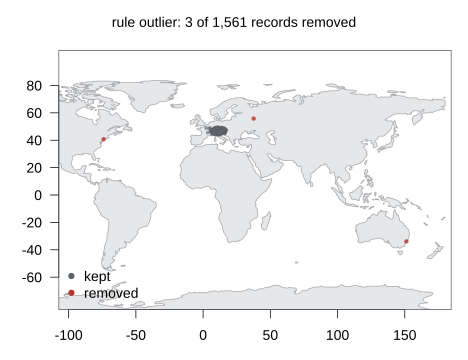
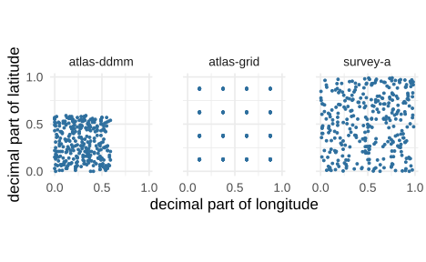

# Outliers and dataset tests

Six tests compare records within a species or dataset rather than
against external reference data. These include `outlier`, which
identifies geographic outliers within a species; three fossil outlier
tests; and `dataset_ddmm` and `dataset_rounded`, which detect coordinate
conversion and gridding errors across a dataset. They correspond to
CoordinateCleaner’s
[`cc_outl()`](https://ropensci.github.io/CoordinateCleaner/reference/cc_outl.html),
[`cf_age()`](https://ropensci.github.io/CoordinateCleaner/reference/cf_age.html),
[`cf_outl()`](https://ropensci.github.io/CoordinateCleaner/reference/cf_outl.html),
[`cf_range()`](https://ropensci.github.io/CoordinateCleaner/reference/cf_range.html),
[`cd_ddmm()`](https://ropensci.github.io/CoordinateCleaner/reference/cd_ddmm.html),
and
[`cd_round()`](https://ropensci.github.io/CoordinateCleaner/reference/cd_round.html).

Unlike record-level tests, these tests need all records in a group
before they can evaluate any of them. They therefore run in a separate
pass over the input, before the record-level tests.

This article demonstrates the geographic and dataset tests using
simulated alpine plant records. It also introduces the
artificial-hotspot test `aohi` and explains how the group pass handles
streamed input. The fossil tests are covered in [Cleaning fossil
records](https://gillescolling.com/OccurrenceCleaner/articles/fossils.md),
and installation instructions are available in [Get
started](https://gillescolling.com/OccurrenceCleaner/articles/OccurrenceCleaner.md).

## Example data

The table contains 961 records of four alpine plant species from the
Eastern Alps, distributed across three datasets. *Salix retusa* is
represented by only six records. Four herbarium records far outside
their species’ ranges (New York, Sydney, Paris and Moscow) are added,
plus one *Pinus mugo* record within its range as a control. A column
`truth` labels each record.

Two datasets of 300 records each are also added, to test for systematic
coordinate errors. In the first, coordinates were incorrectly converted
from degrees and minutes to decimal degrees, leaving no fractional part
above .59. In the second, coordinates fall on the centres of a
quarter-degree grid.

Simulation code

``` r

library(OccurrenceCleaner)

set.seed(11)
sp <- data.frame(species = c("Erica carnea", "Gentiana verna", "Pinus mugo", "Salix retusa"),
                 lon = c(12, 10, 14, 11), lat = c(47, 46.5, 47.5, 46.8), sd = c(1.5, 2, 1, 1.2),
                 n = c(400, 250, 300, 6))
x <- do.call(rbind, lapply(seq_len(nrow(sp)), function(i)
  data.frame(species = sp$species[i], decimalLongitude = round(rnorm(sp$n[i], sp$lon[i], sp$sd[i]), 5),
             decimalLatitude = round(rnorm(sp$n[i], sp$lat[i], sp$sd[i] / 2), 5))))
x$datasetKey <- sample(c("survey-a", "survey-b", "herbarium"), nrow(x), TRUE)
x$truth <- "clean"
```

``` r

far <- data.frame(species = c("Erica carnea", "Erica carnea", "Gentiana verna", "Pinus mugo", "Pinus mugo"),
                  decimalLongitude = c(-74.0, 151.2, 2.35, 12.1, 37.6), decimalLatitude = c(40.7, -33.9, 48.86, 47.3, 55.8),
                  datasetKey = "herbarium", truth = c("far", "far", "far", "clean", "far"))
ddmm <- data.frame(species = sample(sp$species[1:3], 300, TRUE),
                   decimalLongitude = floor(runif(300, 8, 16)) + sample(0:59, 300, TRUE) / 100,
                   decimalLatitude = floor(runif(300, 45, 48)) + sample(0:59, 300, TRUE) / 100,
                   datasetKey = "atlas-ddmm", truth = "ddmm")
grid <- data.frame(species = sample(sp$species[1:3], 300, TRUE),
                   decimalLongitude = round(runif(300, 8, 16) * 4) / 4 + 0.125,
                   decimalLatitude = round(runif(300, 45, 48) * 4) / 4 + 0.125,
                   datasetKey = "atlas-grid", truth = "grid")
x <- rbind(x, far, ddmm, grid)
```

``` r

head(x, 3)
#>        species decimalLongitude decimalLatitude datasetKey truth
#> 1 Erica carnea         11.11345        48.00728   survey-b clean
#> 2 Erica carnea         12.03989        46.22010   survey-a clean
#> 3 Erica carnea          9.72517        47.88716   survey-a clean
table(x$datasetKey, x$truth)
#>             
#>              clean ddmm far grid
#>   atlas-ddmm     0  300   0    0
#>   atlas-grid     0    0   0  300
#>   herbarium    302    0   4    0
#>   survey-a     326    0   0    0
#>   survey-b     329    0   0    0
```

## Geographic outliers

``` r

f <- flag_occurrences(x, tests = c("invalid", "outlier"))
table(truth = f$truth, outlier = f$flag_outlier)
#>        outlier
#> truth   FALSE TRUE
#>   clean   957    0
#>   ddmm    300    0
#>   far       1    3
#>   grid    300    0
```

Three of the four distant records are flagged, while no clean records
are flagged. For each species, the test calculates every record’s mean
distance to all other records of that species. The threshold is the 75th
percentile of these mean distances (Q75) plus five times their
interquartile range (IQR, the spread between the 25th and 75th
percentiles); a record whose mean distance exceeds it is flagged,
following
[CoordinateCleaner](https://ropensci.github.io/CoordinateCleaner/)’s
default.

The *Gentiana verna* record in Paris is not flagged. The simulated
*Gentiana* records span about 2 degrees of longitude around 10° E, so
the Paris record, at 2.4° E, does not increase the mean distance enough
to exceed the threshold. *Salix retusa* is not tested because its six
distinct locations fall below the default `min_occs = 7`.

The threshold and distance statistic can be changed through `settings`.
With `method = "mad"`, the threshold is the median of the mean distances
plus five times their median absolute deviation (MAD, the median of the
distances from that median). With `method = "distance"`, a record is
flagged if its nearest other record of the same species is more than
`tdi` kilometres away (1000 km by default):

``` r

m <- sapply(c("quantile", "mad", "distance"), function(meth)
  tapply(flag_occurrences(x, tests = "outlier", settings = list(outlier = list(method = meth)))$flag_outlier,
         x$truth, sum))
knitr::kable(m)
```

|       | quantile | mad | distance |
|:------|---------:|----:|---------:|
| clean |        0 |   3 |        0 |
| ddmm  |        0 |   9 |        0 |
| far   |        3 |   4 |        3 |
| grid  |        0 |   3 |        0 |

The MAD threshold is the stricter one here: it catches all four far
records but also 15 records inside the species’ areas, most of them in
the converted atlas, whose coordinates are shifted towards the
south-west of each degree square. The distance method flags the same
three far records as the quantile threshold; the Paris record is within
1000 km of *Gentiana* records in the Alps. The map shows the default
result:

``` r

plot(f, type = "map", rules = list(outlier = "outlier"))
```



CoordinateCleaner’s sampling correction leaves outliers unflagged in
countries with few records, where an isolated record is more likely a
real but poorly documented population than an error. It works in three
steps:

1.  A table of record counts per country is passed as
    `gazetteers = list(sampling = ...)`.

2.  Each country’s record density is compared with the densities of all
    countries in the table. The quantile `sampling_thresh` of these
    densities is the threshold.

3.  An outlier keeps its flag only when its country’s density lies above
    the threshold; in the other countries the flag is lifted.

``` r

counts <- data.frame(country = c("US", "AU", "FR", "RU", "AT", "DE", "IT", "CH", "SI"),
                     records = c(4e8, 1.2e8, 1e8, 6e6, 2.5e7, 1.8e8, 5e7, 4e7, 6e6))
fs <- flag_occurrences(x, tests = c("invalid", "outlier"), gazetteers = list(sampling = counts),
                       settings = list(outlier = list(sampling_thresh = 0.25)))
x[fs$flag_outlier != f$flag_outlier, c("species", "decimalLongitude", "decimalLatitude")]
#>          species decimalLongitude decimalLatitude
#> 957 Erica carnea            -74.0            40.7
#> 958 Erica carnea            151.2           -33.9
#> 961   Pinus mugo             37.6            55.8
```

Russia, Australia and the United States have the three lowest densities
in this table, at or below its 25 % quantile, so the outlier flags on
the records in Moscow, Sydney and New York are lifted. The counts here
are illustrative. Real ones come from `rgbif::occ_count(country = ...)`
for each country, or from a tally of the input itself. The table is
recorded in the reference label by size and checksum.

## Species with many records

For a species with 10,000 records or more the pairwise distances are
replaced by a raster approximation, as in
[CoordinateCleaner](https://ropensci.github.io/CoordinateCleaner/):
records are counted on a 0.5-degree grid spanning the whole input, the
statistic is computed between grid cells with distances weighted by the
cell counts, and the records of the outlier cells are flagged.
`settings = list(outlier = list(thinning = TRUE))` uses the grid for
every species, and `thinning_res` sets the cell size. A species of
15,001 records with one record in Madrid:

``` r

big <- data.frame(species = "Rhododendron ferrugineum",
                  decimalLongitude = c(rnorm(15000, 11, 1.5), -3.7),
                  decimalLatitude = c(rnorm(15000, 46.8, 0.6), 40.4))
system.time(fb <- flag_occurrences(big, tests = "outlier"))
#>    user  system elapsed 
#>    0.03    0.00    0.04
which(fb$flag_outlier)
#> [1] 15001
```

The Madrid record is the only one flagged. CoordinateCleaner 3.0.1 flags
no records on this path; [Compatibility with
CoordinateCleaner](https://gillescolling.com/OccurrenceCleaner/articles/coordinatecleaner.md)
shows the comparison.

## Dataset tests

``` r

d <- flag_occurrences(x, tests = c("invalid", "dataset_ddmm", "dataset_rounded"))
knitr::kable(aggregate(as.data.frame(d)[c("flag_dataset_ddmm", "flag_dataset_rounded")],
                       by = list(dataset = d$datasetKey), FUN = all))
```

| dataset    | flag_dataset_ddmm | flag_dataset_rounded |
|:-----------|:------------------|:---------------------|
| atlas-ddmm | TRUE              | FALSE                |
| atlas-grid | FALSE             | TRUE                 |
| herbarium  | FALSE             | FALSE                |
| survey-a   | FALSE             | FALSE                |
| survey-b   | FALSE             | FALSE                |

`dataset_ddmm` flags every record of the converted atlas and
`dataset_rounded` every record of the gridded one; the three datasets of
clean records pass both. The dataset key is `datasetKey`, GBIF’s
identifier of the publishing dataset, and can be set with
`occ_columns(dataset = ...)`. Records without a key are not tested. The
two tests read different signs, which the decimal parts of the
coordinates show:

``` r

library(ggplot2)
dec <- data.frame(dataset = x$datasetKey,
                  lon = x$decimalLongitude %% 1, lat = x$decimalLatitude %% 1)
dec <- dec[dec$dataset %in% c("survey-a", "atlas-ddmm", "atlas-grid"), ]
ggplot(dec, aes(lon, lat)) +
  geom_point(size = 0.8, colour = "#2E6F9E") +
  facet_wrap(~dataset) +
  coord_equal() +
  scale_x_continuous(breaks = c(0, 0.5, 1)) +
  scale_y_continuous(breaks = c(0, 0.5, 1)) +
  labs(x = "decimal part of longitude", y = "decimal part of latitude") +
  theme_minimal(base_size = 17) +
  theme(panel.spacing = unit(2, "lines"),
        panel.background = element_rect(fill = "transparent", colour = NA),
        plot.background = element_rect(fill = "transparent", colour = NA))
```



The two tests look for different patterns in a dataset’s coordinates.

`dataset_ddmm` detects incorrect conversions from degrees and minutes to
decimal degrees. In correctly converted coordinates, the decimal part
can range from 0 to 1. With the conversion error, it never exceeds 0.59.
The test looks for this missing range using a binomial test on a 1000 ×
1000 grid.

`dataset_rounded` detects coordinates placed on a regular grid. Instead
of taking many different values, the coordinates occur at fixed
intervals. The test identifies this spacing through the autocorrelation
of latitude and longitude histograms.

In this example, the degree-minute atlas has the conversion error but no
regular grid. The gridded atlas has decimal parts of 0.125, 0.375, 0.625
and 0.875 on both axes, but no conversion error. Each atlas is therefore
flagged by only one test.

## Artificial hotspots

``` r

ah <- reference_points("aohi")
h <- data.frame(species = "Erica carnea", decimalLongitude = ah$lon[ah$taxon == "Plantae"][1:3] + 0.03,
                decimalLatitude = ah$lat[ah$taxon == "Plantae"][1:3])
data.frame(hotspot = ah$notes[ah$taxon == "Plantae"][1:3],
           flagged = flag_occurrences(h, tests = "aohi")$flag_aohi)
#>                       hotspot flagged
#> 1            zero coordinates    TRUE
#> 2  Reserva Natural La Planada    TRUE
#> 3 center of a 4km grid square    TRUE
```

`aohi` flags records within 10 km of a point of the Artificial Hotspot
Occurrence Inventory (Park et al. 2023): the coordinates that recur most
often in GBIF plant, bird, insect and mammal records, such as (0, 0), a
nature reserve or the centre of a mapping-grid square. The inventory’s
`notes` and `determination` columns say why a point recurs and whether
it is a real observation site, so it can be filtered before use ([Custom
reference points and
polygons](https://gillescolling.com/OccurrenceCleaner/articles/gazetteers.md)).

## One rule over all of them

``` r

all_f <- flag_occurrences(x, tests = c("invalid", "outlier", "dataset_ddmm", "dataset_rounded", "aohi"))
t <- tally_flags(all_f, by = "datasetKey",
                 rules = list(grouped = c("outlier", "dataset_ddmm", "dataset_rounded", "aohi")))
knitr::kable(t[, c("datasetKey", "n", "flagged_outlier", "flagged_dataset_ddmm",
                   "flagged_dataset_rounded", "flagged_aohi", "removed_grouped", "kept_grouped")])
```

| datasetKey | n | flagged_outlier | flagged_dataset_ddmm | flagged_dataset_rounded | flagged_aohi | removed_grouped | kept_grouped |
|:---|---:|---:|---:|---:|---:|---:|---:|
| atlas-ddmm | 300 | 0 | 300 | 0 | 1 | 300 | 0 |
| atlas-grid | 300 | 0 | 0 | 300 | 3 | 300 | 0 |
| herbarium | 306 | 3 | 0 | 0 | 4 | 6 | 300 |
| survey-a | 326 | 0 | 0 | 0 | 0 | 0 | 326 |
| survey-b | 329 | 0 | 0 | 0 | 0 | 0 | 329 |

Both atlases are removed entirely. The herbarium loses six records:
three geographic outliers and four records near known artificial
hotspots, with one record flagged by both tests.

The New York record lies 5 km from Central Park, a bird-recording
hotspot. The Paris record, which passed the outlier test, lies 3.7 km
from the centre of a French 10 km mapping grid cell. Two otherwise clean
records in Bavaria are also flagged because they lie near centres of the
German floristic mapping grid.

The `aohi` flags in the atlases reflect similar patterns. Whether these
records should be removed depends on whether grid-centre coordinates are
suitable for the analysis.

## Streamed input

For input stored across multiple files, the group pass runs before the
record-level tests. It reads all files twice. The first pass counts
records per species and determines the coordinate range of each dataset.
The second collects the information needed to test each group.

To limit memory use, small species groups and fossil taxa are written to
hashed bucket files, large species are counted on a grid, and dataset
summaries are updated as records are read. This avoids loading the
entire input into memory.

Records of the same species or dataset are tested together, even when
spread across files. The results are saved in `group_result.rds` in the
output directory, so a resumed run can skip the group pass. Splitting
the example table into three files produces the same tally as processing
it as a data frame:

``` r

src <- file.path(tempdir(), "parts"); dir.create(src, showWarnings = FALSE)
for (i in 1:3) vectra::write_vtr(x[seq(i, nrow(x), 3), ], file.path(src, sprintf("part-%d.vtr", i)))
out <- file.path(tempdir(), "flags-grouped")
s <- flag_occurrences(src, tests = c("invalid", "outlier", "dataset_ddmm", "dataset_rounded"),
                      out = out, keep = c("species", "datasetKey"), verbose = FALSE)
st <- tally_flags(s, by = "datasetKey", rules = list(grouped = c("outlier", "dataset_ddmm", "dataset_rounded")))
identical(st$removed_grouped, tally_flags(flag_occurrences(x, tests = c("invalid", "outlier", "dataset_ddmm",
                                                                       "dataset_rounded")),
                                          by = "datasetKey",
                                          rules = list(grouped = c("outlier", "dataset_ddmm", "dataset_rounded")))$removed_grouped)
#> [1] TRUE
```

The flags agree record by record as well; the package’s tests check that
for every grouped test, including the fossil tests with their random age
draws.

## Practical guidance

- **A grouped flag depends on the rest of the input.** Adding records of
  a species can turn an outlier into a normal record, and removing a
  dataset’s records changes nothing for the other datasets. Run the
  grouped tests on the table that goes into the analysis, after
  taxonomic filtering, not on a larger extract.

- **The quantile threshold is the conservative default.** At Q75 + 5 x
  IQR it flagged three of four far records and no clean one here; the
  MAD threshold flagged all four plus 15 records inside the species’
  areas. `mltpl` moves either threshold.

- **Species below `min_occs` distinct points are not tested.** With
  fewer than 7 points the spread of the distances says little;
  `min_occs` can be raised, not usefully lowered below a handful.

- **The dataset tests need a dataset key and a reasonable span.**
  `dataset_ddmm` tests only datasets spanning at least `min_span`
  degrees (2) on both axes; `dataset_rounded` needs at least
  `min_unique_ds_size` distinct points (4) and reads histogram
  regularities, so a small or highly clustered dataset can be flagged by
  it without being gridded. Its result is best read per dataset, with
  `tally_flags(by = "datasetKey")`, before it goes into a rule.

- **A raster approximation answers a coarser question.** For species of
  10,000 records or more, a cell of 0.5 degrees is the unit: a single
  far record forms its own cell and is flagged, but an outlier cell next
  to the main range is not.

## References

Park DS, Xie Y, Thammavong HT, Tulaiha R, Feng X (2023). Artificial
Hotspot Occurrence Inventory (AHOI). *Journal of Biogeography*
50:441-449. [doi:10.1111/jbi.14543](https://doi.org/10.1111/jbi.14543)

Zizka A, Silvestro D, Andermann T, Azevedo J, Duarte Ritter C, Edler D,
Farooq H, Herdean A, Ariza M, Scharn R, Svanteson S, Wengström N, Zizka
V, Antonelli A (2019). CoordinateCleaner: standardized cleaning of
occurrence records from biological collection databases. *Methods in
Ecology and Evolution* 10:744-751.
[doi:10.1111/2041-210X.13152](https://doi.org/10.1111/2041-210X.13152)
