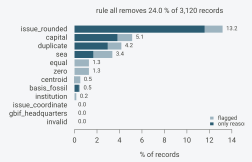
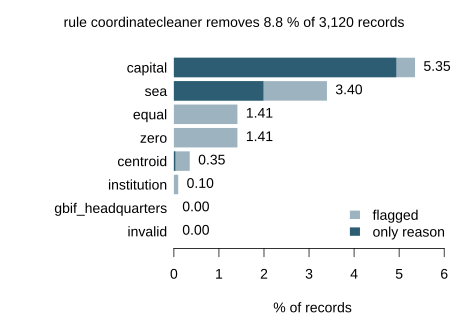
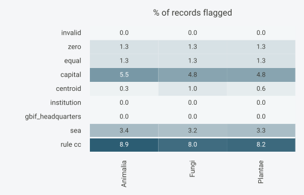
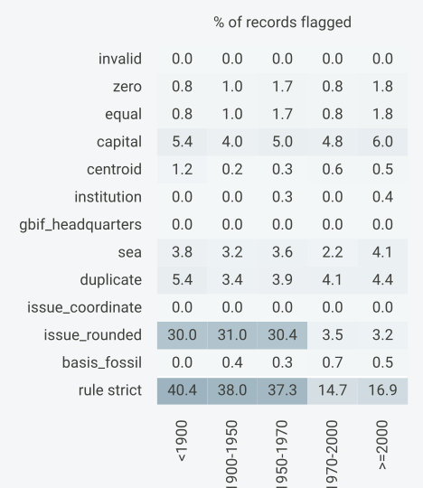
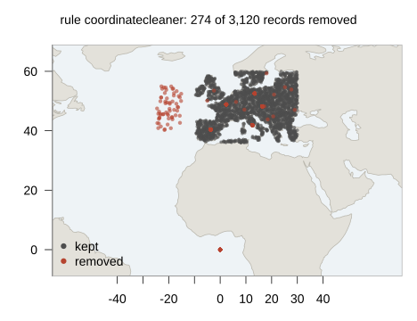

# Choosing a cleaning rule

[`flag_occurrences()`](https://gillescolling.com/OccurrenceCleaner/reference/flag_occurrences.md)
stores each test’s result alongside each record. All records remain in
the table. A cleaning rule specifies which tests to use when filtering:
a record is excluded if any test in the rule flags it. Installation is
covered in [Get
started](https://gillescolling.com/OccurrenceCleaner/articles/OccurrenceCleaner.md).

This article compares how individual tests and cleaning rules affect the
dataset, then applies a chosen rule:

1.  Flag the records with every test of interest using
    [`flag_occurrences()`](https://gillescolling.com/OccurrenceCleaner/reference/flag_occurrences.md).

2.  Compare the share of records flagged by each test and rule using
    [`summary()`](https://rdrr.io/r/base/summary.html) and
    [`plot()`](https://rdrr.io/r/graphics/plot.default.html).

3.  Compare these shares by taxon, record age and coordinate precision
    using
    [`tally_flags()`](https://gillescolling.com/OccurrenceCleaner/reference/tally_flags.md)
    with `by` and `bins`.

4.  Select records using the chosen rule with
    [`keep_unflagged()`](https://gillescolling.com/OccurrenceCleaner/reference/keep_unflagged.md).

## Example

### Example records

The example records are terrestrial: random points on land in Europe,
drawn by rejecting points the `sea` test flags. Each of 60 species
belongs to one kingdom, and each record has a year and the GBIF fields a
download carries. Coordinates are rounded to four decimals.

``` r

library(OccurrenceCleaner)

set.seed(42)
n <- 3000
lon <- runif(3 * n, -10, 30)
lat <- runif(3 * n, 36, 60)
sea <- flag_occurrences(data.frame(decimalLongitude = lon, decimalLatitude = lat),
                        tests = "sea")$flag_sea
kingdoms <- sample(c("Animalia", "Plantae", "Fungi"), 60, TRUE, c(0.5, 0.4, 0.1))
sp <- sample(60, n, TRUE)
x <- data.frame(decimalLongitude = round(lon[!sea][1:n], 4),
                decimalLatitude = round(lat[!sea][1:n], 4),
                kingdom = kingdoms[sp],
                species = paste("species", sp),
                year = sample(1850:2024, n, TRUE, prob = exp(seq(-3, 0, length.out = 175))))
```

The simulation gives records from before 1970 a larger coordinate
uncertainty and assigns GBIF’s `COORDINATE_ROUNDED` issue to 30% of
them, against 3% of later records. The age and uncertainty patterns
later in the article follow from these two choices.

``` r

old <- x$year < 1970
x$coordinateUncertaintyInMeters <- round(rlnorm(n, ifelse(old, 8, 4), 1))
x$coordinateUncertaintyInMeters[sample(n, 600)] <- NA
x$basisOfRecord <- ifelse(old, "PRESERVED_SPECIMEN", "HUMAN_OBSERVATION")
x$basisOfRecord[sample(n, 15)] <- "FOSSIL_SPECIMEN"
x$issue <- ifelse(runif(n) < ifelse(old, 0.3, 0.03), "COORDINATE_ROUNDED", "")
x$issue[sample(n, 40)] <- "TAXON_MATCH_FUZZY;GEODETIC_DATUM_ASSUMED_WGS84"
```

Move 150 records to within 3 km of five capitals, 40 to (0, 0) and 60
into the Atlantic, rounded to four decimals like the rest, along with
exact copies of earlier records.

``` r

capitals <- data.frame(lon = c(16.37, 2.35, 13.40, -3.70, 12.50),
                       lat = c(48.21, 48.86, 52.52, 40.42, 41.90))
i <- sample(n, 250)
cap <- i[1:150]; orig <- i[151:190]; atl <- i[191:250]
j <- sample(5, 150, TRUE)
x$decimalLongitude[cap] <- round(capitals$lon[j] + runif(150, -0.02, 0.02), 4)
x$decimalLatitude[cap] <- round(capitals$lat[j] + runif(150, -0.02, 0.02), 4)
x[orig, c("decimalLongitude", "decimalLatitude")] <- 0
x$decimalLongitude[atl] <- round(runif(60, -25, -15), 4)
x$decimalLatitude[atl] <- round(runif(60, 40, 55), 4)
x <- rbind(x, x[sample(n, 120), ])
nrow(x)
#> [1] 3120
```

### Flag once

The tests are the CoordinateCleaner tests that need only coordinates and
a species, the GBIF issue flags on coordinates and rounding, and the
fossil test on the basis of record. Without `tests`,
[`flag_occurrences()`](https://gillescolling.com/OccurrenceCleaner/reference/flag_occurrences.md)
would run every test the columns allow; naming them here keeps the
comparison to these twelve.

``` r

cc_tests <- c("invalid", "zero", "equal", "capital", "centroid", "institution",
              "gbif_headquarters", "sea", "duplicate")
tests <- c(cc_tests, "issue_coordinate", "issue_rounded", "basis_fossil")
f <- flag_occurrences(x, tests = tests)
setdiff(names(f), names(x))
#>  [1] "flags"                  "flag_invalid"           "flag_zero"             
#>  [4] "flag_equal"             "flag_capital"           "flag_centroid"         
#>  [7] "flag_institution"       "flag_gbif_headquarters" "flag_sea"              
#> [10] "flag_duplicate"         "flag_issue_coordinate"  "flag_issue_rounded"    
#> [13] "flag_basis_fossil"
```

The result is `x` with a `flags` column and one logical `flag_<test>`
column per test.

### What each test removes

[`summary()`](https://rdrr.io/r/base/summary.html) turns the flags into
shares of records. Without a `rules` argument it uses one rule, `all`,
holding every test that was run.

``` r

summary(f)
#> <occ_summary> 3,120 records
#>   rule all: removes 745 (23.88 %)
#>  rule              test    n flagged   pct only pct_only
#>   all           invalid 3120       0  0.00    0     0.00
#>   all              zero 3120      44  1.41    0     0.00
#>   all             equal 3120      44  1.41    0     0.00
#>   all           capital 3120     167  5.35  135     4.33
#>   all          centroid 3120      11  0.35    1     0.03
#>   all       institution 3120       3  0.10    0     0.00
#>   all gbif_headquarters 3120       0  0.00    0     0.00
#>   all               sea 3120     106  3.40   50     1.60
#>   all         duplicate 3120     131  4.20   95     3.04
#>   all  issue_coordinate 3120       0  0.00    0     0.00
#>   all     issue_rounded 3120     394 12.63  349    11.19
#>   all      basis_fossil 3120      16  0.51   11     0.35
#>   all             (any) 3120     745 23.88
```

For each test of the rule, `flagged` is the number of records carrying
that test and `pct` the same as a percentage of all records. `only`
counts the records for which that test is the sole flag among the rule’s
tests: dropping that test from the rule would keep exactly these
records. The row `(any)` is the rule itself, the records that carry at
least one of its tests.

A record can fail several tests at once. The 44 records at (0, 0), the
40 moved there and 4 of the copies, are flagged by `zero`, `equal`
(\|0\| = \|0\|) and `sea`, so none of them is counted under `only`. The
per-test shares therefore add up to more than the rule’s total. The
rule’s `pct` minus the sum of the `pct_only` shares is the share of
records flagged by more than one of its tests. `pct` says how often a
test flags a record; `pct_only` says how much of the rule’s loss would
disappear without that test.

The same numbers as a plot: the full bar is `pct`, the dark part
`pct_only`.

``` r

plot(f)
```



### Comparing rules

Candidate rules go into `rules` as a named list. This example compares
three, with names that label them for this article:

- `strict` uses all twelve tests.

- `coordinatecleaner` uses the eight tests of this set that
  [CoordinateCleaner](https://ropensci.github.io/CoordinateCleaner/)’s
  [`clean_coordinates()`](https://ropensci.github.io/CoordinateCleaner/reference/clean_coordinates.html)
  runs by default: `invalid`, `zero`, `equal`, `capital`, `centroid`,
  `institution`, `gbif_headquarters` and `sea`. That default also runs
  an outlier test, which this example leaves out, and does not run the
  duplicate test.

- `minimal` uses `invalid`, `zero` and `sea`: coordinates outside the
  valid range, on either zero axis or near (0, 0), and in the sea. For
  terrestrial records such as these, the three screen for misplaced
  coordinates; for marine species, `sea` would remove valid records.

``` r

rules <- list(strict = tests,
              coordinatecleaner = setdiff(cc_tests, "duplicate"),
              minimal = c("invalid", "zero", "sea"))
s <- summary(f, rules = rules)
s[s$test == "(any)", c("rule", "n", "flagged", "pct")]
#>               rule    n flagged   pct
#>             strict 3120     745 23.88
#>  coordinatecleaner 3120     274  8.78
#>            minimal 3120     106  3.40
```

The selection above keeps one row per rule.
[`plot()`](https://rdrr.io/r/graphics/plot.default.html) draws one rule
at a time. This plot and the kingdom comparison below use
`coordinatecleaner`, the rule applied at the end of this article:

``` r

plot(s, rule = "coordinatecleaner")
```



The records at (0, 0) again count under no `only`. The capital test is
the sole reason for most of its records.

### By group

The arguments of
[`tally_flags()`](https://gillescolling.com/OccurrenceCleaner/reference/tally_flags.md)
pass through [`summary()`](https://rdrr.io/r/base/summary.html), so `by`
splits the shares by any column of the records. Each percentage is out
of the records in its own group.

``` r

s <- summary(f, rules = rules["coordinatecleaner"], by = "kingdom")
s[s$test %in% c("capital", "sea", "(any)"), ]
#> <occ_summary> 3,120 records, grouped by kingdom
#>   kingdom              rule    test    n flagged  pct only pct_only
#>  Animalia coordinatecleaner capital 1770      92 5.20   85     4.80
#>  Animalia coordinatecleaner     sea 1770      64 3.62   36     2.03
#>  Animalia coordinatecleaner   (any) 1770     156 8.81              
#>     Fungi coordinatecleaner capital  311      20 6.43   17     5.47
#>     Fungi coordinatecleaner     sea  311       6 1.93    3     0.96
#>     Fungi coordinatecleaner   (any)  311      26 8.36              
#>   Plantae coordinatecleaner capital 1039      55 5.29   52     5.00
#>   Plantae coordinatecleaner     sea 1039      36 3.46   23     2.21
#>   Plantae coordinatecleaner   (any) 1039      92 8.85
```

With grouping, [`plot()`](https://rdrr.io/r/graphics/plot.default.html)
shows a grid of tests by groups, shaded by the share each test flags in
each group, with the rule itself in the bottom row.

``` r

plot(f, rules = rules["coordinatecleaner"], by = "kingdom")
```



### Record age and coordinate precision

Year and coordinate uncertainty stay raw columns of the records and are
cut into classes only when tallying. `bins` takes the break points and
adds a `<column>_bin` grouping column. Each class includes its lower
break and excludes its upper one, so `1950-1970` holds the years 1950 to
1969. Values below the first break form `<1900`, values from the last
break on form `>=2000`, and missing values form the class `missing`.
Each percentage is out of the records in its class.

This section reads the shares under `strict`, the only one of the three
rules that includes `issue_rounded`, so the share of records with GBIF’s
rounding issue can be followed across age and uncertainty classes.

``` r

t <- tally_flags(f, rules = rules,
                 bins = list(year = c(1900, 1950, 1970, 2000)))
s <- summary(t)
s[s$rule == "strict" & s$test %in% c("issue_rounded", "(any)"),
  c("year_bin", "test", "n", "pct")]
#>   year_bin          test    n   pct
#>      <1900 issue_rounded  223 26.91
#>      <1900         (any)  223 35.87
#>  1900-1950 issue_rounded  505 31.09
#>  1900-1950         (any)  505 39.21
#>  1950-1970 issue_rounded  364 31.04
#>  1950-1970         (any)  364 40.38
#>  1970-2000 issue_rounded  867  3.11
#>  1970-2000         (any)  867 15.80
#>     >=2000 issue_rounded 1161  3.19
#>     >=2000         (any) 1161 15.76
```

The higher `issue_rounded` share before 1970 reproduces the rate the
simulation assigned to older records.

[`tally_flags()`](https://gillescolling.com/OccurrenceCleaner/reference/tally_flags.md)
returns the counts; [`summary()`](https://rdrr.io/r/base/summary.html)
on its result gives the percentages, and
[`plot()`](https://rdrr.io/r/graphics/plot.default.html) the grid. The
tally is the one to keep when the counts will be summed or merged later.

``` r

plot(t, rule = "strict")
```



The same works for coordinate uncertainty,
`coordinateUncertaintyInMeters`, a distance in metres describing how
uncertain the stated location is:

``` r

t <- tally_flags(f, rules = rules["strict"],
                 bins = list(coordinateUncertaintyInMeters = c(100, 1000, 10000)))
s <- summary(t)
s[s$test %in% c("issue_rounded", "(any)"),
  c("coordinateUncertaintyInMeters_bin", "test", "n", "pct")]
#>  coordinateUncertaintyInMeters_bin          test    n   pct
#>                               <100 issue_rounded 1203  2.66
#>                               <100         (any) 1203 15.05
#>                           100-1000 issue_rounded  544  9.38
#>                           100-1000         (any)  544 21.69
#>                         1000-10000 issue_rounded  645 30.08
#>                         1000-10000         (any)  645 39.53
#>                            >=10000 issue_rounded  102 27.45
#>                            >=10000         (any)  102 30.39
#>                            missing issue_rounded  626 14.22
#>                            missing         (any)  626 25.56
```

The simulation drew larger uncertainties for older records, so the share
with the rounding issue is highest in the classes from 1 km up.

### Where the removed records are

On a flagged data frame, `plot(type = "map")` draws the records over the
Natural Earth land, coloured by whether the first rule of `rules`
removes them. The map returns to `coordinatecleaner`, the rule applied
below.

``` r

plot(f, type = "map", rules = rules["coordinatecleaner"])
```



### Applying the rule

Choose the tests by what your analysis needs. Suppose the example
records are used to map where each species occurs on a 10 km grid.
Coordinates that may point to a capital, a country centroid, an
institution, GBIF’s headquarters or the sea can place a record in the
wrong cell, so the example applies `coordinatecleaner`. Repeated records
of a species at the same coordinates fall in the same cell and leave the
map unchanged, so `duplicate` stays out of the rule.

Other analyses add other tests:

- `basis_fossil` when the analysis concerns living populations.

- `duplicate` when each combination of species and coordinates should
  count once, for example in a presence-only distribution model.

- `issue_coordinate` to exclude records with GBIF’s georeferencing
  warnings.

`issue_rounded` is left out. GBIF sets `COORDINATE_ROUNDED` when the
original coordinate was modified by rounding to five decimals ([GBIF
issue
definition](https://gbif.github.io/gbif-api/apidocs/org/gbif/api/vocabulary/OccurrenceIssue.html#COORDINATE_ROUNDED)).
A precision threshold can be taken from coordinate uncertainty instead.

[`keep_unflagged()`](https://gillescolling.com/OccurrenceCleaner/reference/keep_unflagged.md)
keeps the records that carry no flag from the rule.
[`has_flag()`](https://gillescolling.com/OccurrenceCleaner/reference/flag_mask.md)
gives the logical vector behind it, `TRUE` for every record carrying at
least one test of the rule.

``` r

clean <- keep_unflagged(f, rules$coordinatecleaner)
nrow(clean)
#> [1] 2846
```

A cut on record age or coordinate uncertainty is a filter on the raw
columns, with an explicit choice for missing values. This one keeps
records from 1950 on, and records whose coordinate uncertainty is at
most 10 km or not stated:

``` r

u <- clean$coordinateUncertaintyInMeters
keep <- !is.na(clean$year) & clean$year >= 1950 & (is.na(u) | u <= 10000)
sum(keep)
#> [1] 2143
```

The removed records keep their flags. Another rule built from the tests
already run reads the same `f`. Adding a test that was not run, or
changing buffers, `settings`, reference data or the land scale, needs a
new call to
[`flag_occurrences()`](https://gillescolling.com/OccurrenceCleaner/reference/flag_occurrences.md).

To compare with
[`clean_coordinates()`](https://ropensci.github.io/CoordinateCleaner/reference/clean_coordinates.html)
output, both packages need the same tests, buffers and reference data.
At its defaults,
[`clean_coordinates()`](https://ropensci.github.io/CoordinateCleaner/reference/clean_coordinates.html)
adds its outlier test and draws the sea test from the 1:50 million land,
while
[`flag_occurrences()`](https://gillescolling.com/OccurrenceCleaner/reference/flag_occurrences.md)
uses the 1:110 million land and its own gazetteers; `land_scale = 50`
and `reference = "CoordinateCleaner"` align the last two. [Compatibility
with
CoordinateCleaner](https://gillescolling.com/OccurrenceCleaner/articles/coordinatecleaner.md)
maps the remaining arguments.

## How the shares are computed

[`flag_occurrences()`](https://gillescolling.com/OccurrenceCleaner/reference/flag_occurrences.md)
returns its input with class `occ_flags`, and
[`summary()`](https://rdrr.io/r/base/summary.html) returns a data frame
of class `occ_summary`.
[`summary()`](https://rdrr.io/r/base/summary.html) and
[`plot()`](https://rdrr.io/r/graphics/plot.default.html) dispatch on
these classes; rows of a summary are selected as in any data frame.

All counts come from the integer flag word $`w`$ of each record, in
which each test $`t`$ has one bit. Write $`m_t`$ for the mask with only
the bit of $`t`$ set, $`m_T`$ for the mask of a rule’s tests $`T`$
(`flag_mask(T)`), and $`\mathbin{\&}`$ for bitwise AND. A record is

- flagged by test $`t`$ when $`w \mathbin{\&} m_t \neq 0`$,

- removed by the rule when $`w \mathbin{\&} m_T \neq 0`$,

- removed by $`t \in T`$ alone when $`w \mathbin{\&} m_T = m_t`$.

A removed record carries either one test of the rule or several. The
rule’s removed count minus the sum of the `only` counts over $`t \in T`$
is therefore the number of records flagged by more than one test of the
rule.

[`tally_flags()`](https://gillescolling.com/OccurrenceCleaner/reference/tally_flags.md)
counts these per group in one pass over the flags, which is also how it
runs on on-disk output part by part (see [Large tables on
disk](https://gillescolling.com/OccurrenceCleaner/articles/on-disk.md)).
