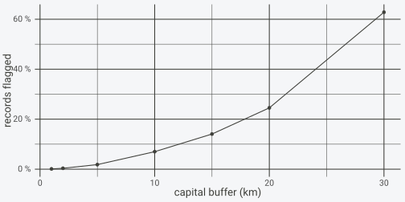

# The tests in detail

This article goes through the nineteen tests one by one: what each
computes, which fields it reads, where its edge lies, and how its result
can be changed through an argument. The first eleven reproduce the
record tests of CoordinateCleaner (Zizka et
al. [2019](https://doi.org/10.1111/2041-210X.13152)) with its default
buffers; the other eight read GBIF fields and are additions of this
package. Each test also has a help page of its own
([`?test_capital`](https://gillescolling.com/OccurrenceCleaner/reference/test_capital.md),
[`?test_sea`](https://gillescolling.com/OccurrenceCleaner/reference/test_sea.md),
…).

``` r

library(OccurrenceCleaner)
```

## The flag word

Every test owns one bit of an integer.
[`flag_tests()`](https://gillescolling.com/OccurrenceCleaner/reference/flag_tests.md)
lists the layout, the fields each test needs and its CoordinateCleaner
counterpart:

``` r

knitr::kable(flag_tests()[, c("bit", "test", "needs", "source", "equivalent")])
```

| bit | test                     | needs           | source            | equivalent |
|----:|:-------------------------|:----------------|:------------------|:-----------|
|   0 | invalid                  | lon,lat         | CoordinateCleaner | cc_val     |
|   1 | zero                     | lon,lat         | CoordinateCleaner | cc_zero    |
|   2 | equal                    | lon,lat         | CoordinateCleaner | cc_equ     |
|   3 | capital                  | lon,lat         | CoordinateCleaner | cc_cap     |
|   4 | centroid                 | lon,lat         | CoordinateCleaner | cc_cen     |
|   5 | institution              | lon,lat         | CoordinateCleaner | cc_inst    |
|   6 | gbif_headquarters        | lon,lat         | CoordinateCleaner | cc_gbif    |
|   7 | sea                      | lon,lat         | CoordinateCleaner | cc_sea     |
|   8 | urban                    | lon,lat         | CoordinateCleaner | cc_urb     |
|   9 | country_mismatch         | lon,lat,country | CoordinateCleaner | cc_coun    |
|  10 | duplicate                | lon,lat,species | CoordinateCleaner | cc_dupl    |
|  11 | issue_coordinate         | issue           | OccurrenceCleaner | NA         |
|  12 | issue_taxon              | issue           | OccurrenceCleaner | NA         |
|  13 | issue_date               | issue           | OccurrenceCleaner | NA         |
|  14 | issue_rounded            | issue           | OccurrenceCleaner | NA         |
|  15 | basis_fossil             | basis           | OccurrenceCleaner | NA         |
|  16 | basis_living             | basis           | OccurrenceCleaner | NA         |
|  17 | establishment_introduced | establishment   | OccurrenceCleaner | NA         |
|  18 | establishment_managed    | establishment   | OccurrenceCleaner | NA         |

``` r

attr(flag_tests(), "layout_version")
#> [1] 1
```

A record’s flag word is the sum of `2^bit` over the tests it fails, so a
word of 10 (`2^1 + 2^3`) means `zero` and `capital`.
[`flag_mask()`](https://gillescolling.com/OccurrenceCleaner/reference/flag_mask.md)
turns a set of tests into such a word and
[`has_flag()`](https://gillescolling.com/OccurrenceCleaner/reference/flag_mask.md)
asks whether a word carries any test of a set:

``` r

flag_mask(c("zero", "capital"))
#> [1] 10
has_flag(c(0L, 2L, 8L, 10L, 16L), c("zero", "capital"))
#> [1] FALSE  TRUE  TRUE  TRUE FALSE
```

The layout carries a version number. A change to it (a new bit, a
redefined test) increases the version, and flags written to disk record
the version they were made with, so a stored flag word is never read
against the wrong layout.

Tests run only when asked for, through `tests`. Without the argument,
[`flag_occurrences()`](https://gillescolling.com/OccurrenceCleaner/reference/flag_occurrences.md)
runs
[`default_tests()`](https://gillescolling.com/OccurrenceCleaner/reference/default_tests.md),
the CoordinateCleaner-equivalent tests that need only coordinates and a
species:

``` r

default_tests()
#> [1] "invalid"           "zero"              "equal"            
#> [4] "capital"           "centroid"          "institution"      
#> [7] "gbif_headquarters" "sea"               "duplicate"
```

## Coordinate validity: `invalid`

A coordinate is invalid when it is missing, not a number, or outside
\[-180, 180\] x \[-90, 90\]. Text columns are coerced to numbers first,
as in CoordinateCleaner’s `cc_val`:

``` r

x <- data.frame(species = "a",
                decimalLongitude = c("16.37", "abc", NA, "200", "-180"),
                decimalLatitude = c("48.21", "10", "10", "10", "-90"))
f <- flag_occurrences(x, tests = c("invalid", "zero", "sea"))
f[, c("decimalLongitude", "decimalLatitude", "flag_invalid", "flag_zero", "flag_sea")]
#>   decimalLongitude decimalLatitude flag_invalid flag_zero flag_sea
#> 1            16.37           48.21        FALSE     FALSE    FALSE
#> 2              abc              10         TRUE     FALSE    FALSE
#> 3             <NA>              10         TRUE     FALSE    FALSE
#> 4              200              10         TRUE     FALSE    FALSE
#> 5             -180             -90        FALSE     FALSE    FALSE
```

A record that fails `invalid` gets no other spatial flag: there is no
point to test, so `zero` and `sea` stay `FALSE` for the second to fourth
rows. CoordinateCleaner instead returns `NA` or “clean” for such rows
depending on the test; the comparison article lists the cases. The
boundary values (-180, -90) are valid.

## Zero and equal coordinates: `zero`, `equal`

`zero` flags records with a longitude or latitude of exactly zero, and
records within 0.5 degrees of (0, 0), measured as a planar distance in
degrees. `equal` flags records whose absolute longitude equals their
absolute latitude, a common data-entry error where one value was copied
into both fields:

``` r

x <- data.frame(species = "a",
                decimalLongitude = c(0, 25.3, 0.3, 0.4, 10, -10, 10.0001),
                decimalLatitude = c(42.1, 0, 0.3, 0.4, 10, 10, 10))
f <- flag_occurrences(x, tests = c("zero", "equal"))
cbind(x[, 2:3], dist_deg = round(sqrt(x[, 2]^2 + x[, 3]^2), 3), f[, c("flag_zero", "flag_equal")])
#>   decimalLongitude decimalLatitude dist_deg flag_zero flag_equal
#> 1           0.0000            42.1   42.100      TRUE      FALSE
#> 2          25.3000             0.0   25.300      TRUE      FALSE
#> 3           0.3000             0.3    0.424      TRUE       TRUE
#> 4           0.4000             0.4    0.566     FALSE       TRUE
#> 5          10.0000            10.0   14.142     FALSE       TRUE
#> 6         -10.0000            10.0   14.142     FALSE       TRUE
#> 7          10.0001            10.0   14.142     FALSE      FALSE
```

The point at (0.3, 0.3) is 0.42 degrees from the origin and flagged, the
one at (0.4, 0.4) is 0.57 degrees away and not. The radius is set with
`buffers = list(zero = ...)` in degrees:

``` r

flag_occurrences(x[3:4, ], tests = "zero", buffers = list(zero = 1))$flag_zero
#> [1] TRUE TRUE
flag_occurrences(x[3:4, ], tests = "zero", buffers = list(zero = 0))$flag_zero
#> [1] FALSE FALSE
```

With `zero = 0` only exact zeros are flagged, which is what
CoordinateCleaner 3.0.1 does in practice; the comparison article
explains why its documented 0.5-degree buffer is not applied there.

## Proximity tests: `capital`, `centroid`, `institution`, `gbif_headquarters`

These four flag records within a fixed distance of a reference point: 10
km of a country capital, 1 km of a country or province centroid, 100 m
of a biodiversity institution, and 1 km of the GBIF secretariat in
Copenhagen (12.58 E, 55.67 N). Records end up at such points when a
collector, a database or a georeferencing tool assigns the coordinates
of the place that holds or names the specimen instead of where it was
found.

The distance is the geodesic distance on the WGS84 ellipsoid, and the
buffer is closed: a record at exactly the buffer distance is flagged.
Candidates are found with a kd-tree on the unit sphere, and each
candidate is decided with the Vincenty inverse formula. The GBIF
headquarters, a single fixed point, show the edge directly. Points due
north of it at 990 m to 1,010 m:

``` r

d <- c(990, 999, 999.9, 1000.1, 1001, 1010)
p <- geosphere::destPoint(c(12.58, 55.67), b = 0, d = d)
x <- data.frame(species = "a", decimalLongitude = p[, 1], decimalLatitude = p[, 2])
data.frame(distance_m = d, flag = flag_occurrences(x, tests = "gbif_headquarters")$flag_gbif_headquarters)
#>   distance_m  flag
#> 1      990.0  TRUE
#> 2      999.0  TRUE
#> 3      999.9  TRUE
#> 4     1000.1 FALSE
#> 5     1001.0 FALSE
#> 6     1010.0 FALSE
```

The flag switches between 999.9 m and 1000.1 m, at the same distance in
every direction. CoordinateCleaner draws each buffer as a polygon with
vertices on the circle, so its edge lies between 99.7 % and 100 % of the
buffer depending on the bearing; records in that thin band are the only
difference between the two packages for these tests.

Buffers are changed per test, in metres:

``` r

flag_occurrences(x, tests = "gbif_headquarters",
                 buffers = list(gbif_headquarters = 995))$flag_gbif_headquarters
#> [1]  TRUE FALSE FALSE FALSE FALSE FALSE
```

A buffer of zero flags only records at the reference coordinates
themselves. The size of the capital buffer matters more than any other,
because 10 km around a capital covers whole cities with real records in
them. Records spread evenly over the 40 km around Vienna show how the
flagged share grows with the buffer:

``` r

set.seed(1)
m <- 3000
p <- geosphere::destPoint(c(16.37, 48.21), b = runif(m, 0, 360), d = 40000 * sqrt(runif(m)))
x <- data.frame(species = "a", decimalLongitude = p[, 1], decimalLatitude = p[, 2])
radii <- c(1, 2, 5, 10, 15, 20, 30) * 1000
share <- vapply(radii, function(r)
  mean(flag_occurrences(x, tests = "capital", buffers = list(capital = r))$flag_capital), numeric(1))
library(ggplot2)
ggplot(data.frame(km = radii / 1000, share = share), aes(km, share)) +
  geom_line() + geom_point() +
  scale_y_continuous(labels = function(v) paste0(100 * v, " %")) +
  labs(x = "capital buffer (km)", y = "records flagged") +
  theme_minimal() +
  theme(panel.background = element_rect(fill = "transparent", colour = NA),
        plot.background = element_rect(fill = "transparent", colour = NA))
```



For records spread evenly over a disc, the share grows with the square
of the buffer. 6.9 % of the records lie within the default 10 km, close
to the 6.25 % of the area that a 10 km circle covers in a 40 km disc
(10²/40²); with 3,000 records the sampling error of that share is about
0.4 percentage points. At 30 km the share rises above the disc ratio (56
%) because the eastern edge of the disc lies within 30 km of Bratislava,
56 km from Vienna, and those records are flagged for the second capital.
On real data the share depends on how the records are distributed around
the capital, which the per-test tally of
[`tally_flags()`](https://gillescolling.com/OccurrenceCleaner/reference/tally_flags.md)
reports directly.

## Land and sea: `sea`

`sea` flags records outside the land polygons of Natural Earth. The land
layer comes at three scales: 1:110m (the default, as in
CoordinateCleaner), 1:50m and 1:10m, set with `land_scale`. The test is
a planar point-in-polygon test in longitude and latitude, through a grid
index whose boundary cells are resolved exactly.

The scale decides the result for records near the coast. The GBIF
headquarters in Copenhagen are on land at 1:110m and in the sea at
1:50m:

``` r

x <- data.frame(species = "a", decimalLongitude = c(12.58, 16.37, -30),
                decimalLatitude = c(55.67, 48.21, 40))
data.frame(x[, 2:3],
           sea_110 = flag_occurrences(x, tests = "sea")$flag_sea,
           sea_50 = flag_occurrences(x, tests = "sea", land_scale = 50)$flag_sea)
#>   decimalLongitude decimalLatitude sea_110 sea_50
#> 1            12.58           55.67   FALSE   TRUE
#> 2            16.37           48.21   FALSE  FALSE
#> 3           -30.00           40.00    TRUE   TRUE
```

The 1:10m layer is downloaded once on first use
([`download_reference()`](https://gillescolling.com/OccurrenceCleaner/reference/download_reference.md))
and cached. The reference-data article measures how many coastal records
change between scales.

## Urban areas: `urban`

`urban` flags records inside the Natural Earth 1:50m urban-area
polygons. It is not in
[`default_tests()`](https://gillescolling.com/OccurrenceCleaner/reference/default_tests.md),
as in CoordinateCleaner’s
[`clean_coordinates()`](https://ropensci.github.io/CoordinateCleaner/reference/clean_coordinates.html),
because records in cities are often correct; it is useful as a separate
column, for example to remove garden and street-tree records of plants:

``` r

x <- data.frame(species = "a", decimalLongitude = c(16.37, 16.51, 15.3),
                decimalLatitude = c(48.21, 48.25, 47.5))
flag_occurrences(x, tests = c("urban", "capital"))[, c("decimalLongitude", "decimalLatitude",
                                                     "flag_urban", "flag_capital")]
#>   decimalLongitude decimalLatitude flag_urban flag_capital
#> 1            16.37           48.21       TRUE         TRUE
#> 2            16.51           48.25       TRUE        FALSE
#> 3            15.30           47.50      FALSE        FALSE
```

The first point is central Vienna. The second is in the north-east of
the city, 11 km from the gazetteer’s point for Vienna (16.365 E, 48.202
N): still inside the urban polygon, but outside the capital buffer. The
third is in rural Styria.

## Country codes: `country_mismatch`

`country_mismatch` flags records whose coordinates fall outside the
country named by their country code, using the Natural Earth 1:50m
country polygons. The record’s code is compared with the polygon’s ISO
alpha-2 code (as GBIF’s `countryCode` gives it), its ISO alpha-3 code
(as CoordinateCleaner expects), and Natural Earth’s own `ADM0_A3` code,
which is filled where ISO has none. Matching is case-insensitive and
ignores surrounding spaces:

``` r

x <- data.frame(species = "a", decimalLongitude = c(16.37, 16.37, 16.37, 16.37, 16.37, -30),
                decimalLatitude = c(48.21, 48.21, 48.21, 48.21, 48.21, 40),
                countryCode = c("AT", "AUT", " at ", "DE", NA, "PT"))
f <- flag_occurrences(x, tests = "country_mismatch")
f[, c("countryCode", "flag_country_mismatch")]
#>   countryCode flag_country_mismatch
#> 1          AT                 FALSE
#> 2         AUT                 FALSE
#> 3         at                  FALSE
#> 4          DE                  TRUE
#> 5        <NA>                  TRUE
#> 6          PT                  TRUE
```

A record without a code is flagged, and so is a record at sea whatever
its code, as in CoordinateCleaner. Both are often what a rule should
remove, but in a table where many records lack a code the test flags all
of them; the per-test tally shows how many before the test goes into a
rule. The column is named through `occ_columns(country = ...)`.

## Duplicates: `duplicate`

`duplicate` flags every record that has the same longitude, latitude and
species as an earlier record in the input. The first occurrence is kept
unflagged, so removing the flagged records leaves one record per
distinct key:

``` r

x <- data.frame(species = c("a", "a", "a", "b", "a"),
                decimalLongitude = c(16.37, 16.37, 16.37, 16.37, 16.3701),
                decimalLatitude = 48.21,
                eventDate = c("2020-05-01", "2020-05-01", "2021-06-03", "2020-05-01", "2020-05-01"))
f <- flag_occurrences(x, tests = "duplicate")
f$flag_duplicate
#> [1] FALSE  TRUE  TRUE FALSE FALSE
```

Two arguments change what counts as the same record. `duplicate_by` adds
columns that must also match, as CoordinateCleaner’s `additions`, so
repeat visits on different dates are kept apart. `duplicate_cell` bins
coordinates to a grid of that size in degrees first, so records in the
same cell count as duplicates:

``` r

flag_occurrences(x, tests = "duplicate", duplicate_by = "eventDate")$flag_duplicate
#> [1] FALSE  TRUE FALSE FALSE FALSE
flag_occurrences(x, tests = "duplicate", duplicate_cell = 0.01)$flag_duplicate
#> [1] FALSE  TRUE  TRUE FALSE  TRUE
```

With `eventDate` as an addition only the second record is a duplicate.
With a 0.01-degree cell the fifth record, about 7 m east of the others,
joins them. The species column (`occ_columns(species = ...)`) can be a
name or a taxon key; a key avoids treating two spellings of one name as
different species.

## GBIF issue flags: `issue_coordinate`, `issue_taxon`, `issue_date`, `issue_rounded`

GBIF attaches issue names to each record while processing it. Four tests
group them: georeferencing problems, taxon matching, dates, and rounded
coordinates. The `issue` column can be a string of names separated by
`;` (or `,`, `|`, space) or a list column of character vectors; case
does not matter:

``` r

x <- data.frame(issue = c("COORDINATE_ROUNDED;GEODETIC_DATUM_ASSUMED_WGS84",
                          "TAXON_MATCH_FUZZY", "recorded_date_unlikely", "", NA,
                          "PRESUMED_SWAPPED_COORDINATE;COUNTRY_COORDINATE_MISMATCH"))
iss <- c("issue_coordinate", "issue_taxon", "issue_date", "issue_rounded")
f <- flag_occurrences(x, tests = iss)
cbind(issue = x$issue, f[paste0("flag_", iss)])
#>                                                     issue flag_issue_coordinate
#> 1         COORDINATE_ROUNDED;GEODETIC_DATUM_ASSUMED_WGS84                 FALSE
#> 2                                       TAXON_MATCH_FUZZY                 FALSE
#> 3                                  recorded_date_unlikely                 FALSE
#> 4                                                                         FALSE
#> 5                                                    <NA>                 FALSE
#> 6 PRESUMED_SWAPPED_COORDINATE;COUNTRY_COORDINATE_MISMATCH                  TRUE
#>   flag_issue_taxon flag_issue_date flag_issue_rounded
#> 1            FALSE           FALSE               TRUE
#> 2             TRUE           FALSE              FALSE
#> 3            FALSE            TRUE              FALSE
#> 4            FALSE           FALSE              FALSE
#> 5            FALSE           FALSE              FALSE
#> 6            FALSE           FALSE              FALSE
```

The groups hold these GBIF issue names:

| test | GBIF issues |
|:---|:---|
| issue_coordinate | COORDINATE_INVALID, COORDINATE_OUT_OF_RANGE, COORDINATE_REPROJECTION_FAILED, COORDINATE_REPROJECTION_SUSPICIOUS, COORDINATE_UNCERTAINTY_METERS_INVALID, COORDINATE_PRECISION_INVALID, GEODETIC_DATUM_INVALID, CONTINENT_COORDINATE_MISMATCH, COUNTRY_COORDINATE_MISMATCH, PRESUMED_SWAPPED_COORDINATE, PRESUMED_NEGATED_LONGITUDE, PRESUMED_NEGATED_LATITUDE, ZERO_COORDINATE |
| issue_taxon | TAXON_MATCH_FUZZY, TAXON_MATCH_HIGHERRANK, TAXON_MATCH_NONE, TAXON_MATCH_AGGREGATE |
| issue_date | RECORDED_DATE_INVALID, RECORDED_DATE_UNLIKELY, RECORDED_DATE_MISMATCH |
| issue_rounded | COORDINATE_ROUNDED |

Issues that record an assumption GBIF made without changing the data,
such as `GEODETIC_DATUM_ASSUMED_WGS84`, are in no group. `issue_rounded`
is kept apart from `issue_coordinate` because rounding is a precision
question: GBIF sets `COORDINATE_ROUNDED` when it rounds coordinates
given with more than five decimals, so the flag says nothing about
whether the record is placed correctly, and a precision threshold is
usually better taken from `coordinateUncertaintyInMeters`.

## Basis of record and establishment means

Four tests read two Darwin Core fields. `basis_fossil` and
`basis_living` flag fossil and living specimens (`basisOfRecord` of
`FOSSIL_SPECIMEN` or `LIVING_SPECIMEN`), which are usually not evidence
of a wild population at the recorded place. `establishment_introduced`
flags `establishmentMeans` of introduced, naturalised or invasive, and
`establishment_managed` flags managed or cultivated individuals:

``` r

x <- data.frame(basisOfRecord = c("HUMAN_OBSERVATION", "LIVING_SPECIMEN", "FOSSIL_SPECIMEN", "PRESERVED_SPECIMEN"),
                establishmentMeans = c(NA, "MANAGED", "NATIVE", "Naturalised"))
f <- flag_occurrences(x, tests = c("basis_fossil", "basis_living", "establishment_introduced",
                                   "establishment_managed"))
f[, -(1:3)]
#>   flag_basis_fossil flag_basis_living flag_establishment_introduced
#> 1             FALSE             FALSE                         FALSE
#> 2             FALSE              TRUE                         FALSE
#> 3              TRUE             FALSE                         FALSE
#> 4             FALSE             FALSE                          TRUE
#>   flag_establishment_managed
#> 1                      FALSE
#> 2                       TRUE
#> 3                      FALSE
#> 4                      FALSE
```

Whether introduced records should be removed depends entirely on the
question: a native-range model drops them, an invasion study keeps only
them. The flag is there so the choice is made in the rule.

## Choosing columns

Each test reads only the fields in its `needs` column, and only those
fields have to exist.
[`occ_columns()`](https://gillescolling.com/OccurrenceCleaner/reference/occ_columns.md)
names them; the defaults are Darwin Core terms, matched exactly first
and then case-insensitively:

``` r

x <- data.frame(taxon = "a", X = 16.37, Y = 48.21)
flag_occurrences(x, tests = c("capital", "duplicate"),
                 columns = occ_columns(lon = "X", lat = "Y", species = "taxon"))$flags
#> [1] 8
```

A test whose field is missing stops with an error that names the column,
so a misspelt column never silently skips a test.

## References

Zizka A, Silvestro D, Andermann T, Azevedo J, Duarte Ritter C, Edler D,
Farooq H, Herdean A, Ariza M, Scharn R, Svanteson S, Wengström N, Zizka
V, Antonelli A (2019). CoordinateCleaner: standardized cleaning of
occurrence records from biological collection databases. *Methods in
Ecology and Evolution* 10:744-751.
[doi:10.1111/2041-210X.13152](https://doi.org/10.1111/2041-210X.13152)
